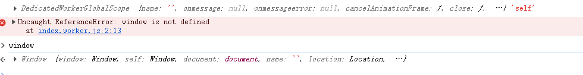
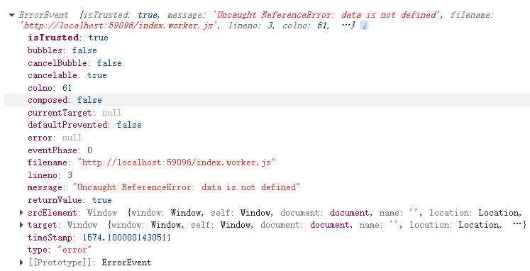
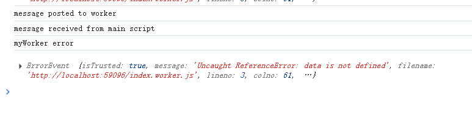
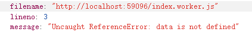

# 什么是webWorker

JavaScript是单线程程语言，如果界面有复杂耗时的计算会影响界面的渲染速度
html5标准提出了webWorker，可以独立创建一个线程去处理这些事物

# 使用方式
定义index.worker.js
界面使用
```js
const worker = new Worker('./index.worker.js')
```

# 特点
1. worker运行在另一个全局上下文中，不同于当前的window。
如果在woker内通过window获取全局作用域会报错


2. 在专用worker(new Worker)的情况下，DedicatedWorkerGlobalScope 表示worker的上下文
共享worker(new SharedWorker)，SharedWorkerGlobalScope 表示worker的上下文

3. 在worker内，不能直接操作DOM节点，也不能使用window对象的默认方法和属性，
但是可以使用window对象之下的一些东西，比如websocket和indexdb

4. 通信通过postMessage和onmessage事件处理函数来响应消息

5. 在主线程中使用，postMessage和onmessage要绑定在worker对象上，
在worker中使用不用这样做，worker是有效的全局作用域

6. worker 发生错误，主线程可以通过onerror事件监听

该事件不会冒泡并且可以被取消；为了防止触发默认动作，worker可以调用错误事件的
preventDefault()

错误事件的部分属性



# subWorker
worker 文件里可以在创建worker，这就是subWorker

# 引入脚本
worker里可以通过全局函数importScripts()引入脚本

# sharedWorker
注意
1. 当两个界面都用到一个sharedWorker，此时改了worker代码，但是如果两个标签页都还在，只刷新一个标签页，那么worker还是用的之前代码
2. 多个标签页用sharedWorker只是共享后台示例，如果想要worker自动把消息推送给所有标签页，需要自己维护port列表
```js
const ports = []

onconnect = (e) => {
    console.log(e, 'shared')
    const port = e.ports[0]
    ports.push(port)

    port.onmessage = (e) => {
        console.log(e,'****port onmessage***')
        const workerResult = `result: ${e.data[0] * e.data[1]}`
        ports.forEach(element => {
            element.postMessage(workerResult)
        });
    }
}
```


# worker中专用api
FileReaderSync(https://developer.mozilla.org/zh-CN/docs/Web/API/FileReaderSync) worker中有效
Media Source Extensions API(
    https://developer.mozilla.org/zh-CN/docs/Web/API/Media_Source_Extensions_API
) 专用worker中有效